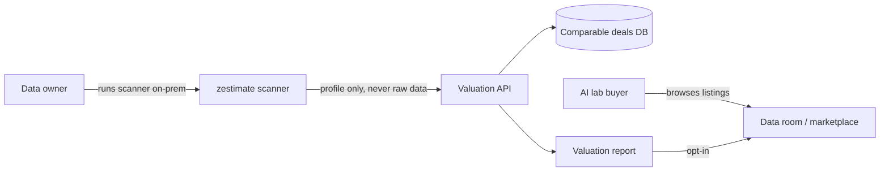

# Architecture — data-zestimate

## 1. Scope
Give a company an instant, explainable price range for licensing a data corpus to AI labs.
**MVP (this repo):** local directory scan → corpus profile → rules-based valuation, CLI + library.
**Product:** hosted scanner agent + comparable-deals database + buyer marketplace ("list it").

## 2. System context

The key boundary: **raw data never leaves the owner's environment**. Only aggregate statistics
(token counts, duplication, domain, licence posture) cross it. That is what makes a first scan a
low-trust action instead of a security review.

## 3. Components
| Module | Responsibility | Status |
|---|---|---|
| `core.scan_dir` | Walk corpus, estimate tokens (chars/4), line-level dedupe via BLAKE2b hashes | MVP |
| `core.value_corpus` | Multiplicative factor model → low/mid/high + factor breakdown | MVP |
| `DOMAIN_RATES`, `LICENSE_FACTORS` | Pricing tables (placeholder comps) | MVP, to be data-driven |
| PII/secret detector | Discount value until scrubbed | Roadmap |
| Novelty estimator | Embedding overlap vs. public corpora (Common Crawl, The Stack) | Roadmap |
| Comps service | Ingests public licensing deals, fits rate curves per domain | Roadmap |

## 4. Data model
- `CorpusProfile{path, files, bytes, tokens, unique_tokens, by_ext}`, where `unique_ratio` is derived
- `Valuation{low, mid, high, factors{unique_mtokens, base_rate, uniqueness, license, freshness, exclusivity}}`

Every factor is stored, so a valuation is fully reproducible and auditable. This matters when
the number goes into a negotiation.

## 5. Key flow
1. Scan: stream files, hash normalised lines into a seen-set, accumulate token counts.
2. Value: `mid = unique_Mtok × rate(domain) × uniqueness × license × freshness × exclusivity`.
3. Range: ±35% spread, which reflects deal-to-deal variance in the comps.

## 6. Design decisions
- **Multiplicative factor model over ML regression.** There are too few public deals to train on,
  and buyers and sellers need to argue about each factor separately. *Trade-off:* it ignores factor
  interactions. Revisit once the comps DB holds more than 200 deals.
- **Line-level dedupe, not MinHash.** It's O(n), exact and dependency-free. *Trade-off:* it misses
  near-duplicates. MinHash-LSH is the planned upgrade for web-scraped corpora.
- **Chars/4 token estimate.** It's within about 10% of BPE tokenisers for English. A pluggable
  tokenizer comes later.

## 7. Production architecture
- **Scanner agent**: a single static binary or container run inside the customer VPC. It emits a
  signed profile JSON.
- **Valuation API** (stateless, FastAPI): `POST /valuations` takes a profile and returns a valuation.
  Pricing tables are versioned, so `pricing_version` is stored with each valuation.
- **Postgres**: profiles, valuations, comps, listings. S3 holds report PDFs.
- **Marketplace**: data-room access control, NDA click-through, sample delivery via presigned URLs.

## 8. Security & privacy
- Profiles contain no content. Even so, line hashes stay local, and only counts are uploaded.
- Signed profiles, so a seller can't inflate token counts when listing.
- Licence posture is self-declared in the MVP. The product needs provenance evidence
  (see dataset-ancestry).

## 9. Scaling & reliability
The scan is I/O-bound. The planned upgrade is parallel file walking plus a streaming hash, with a
target of about 1 TB/hour on NVMe. The API is trivially horizontally scalable. SLO: p95 valuation
under 300 ms.

## 10. Risks & open questions
- Rate tables are the product, and getting real comps is a business-development problem, not an
  engineering one.
- A legal review of "value" claims is needed, so the report states assumptions, not guarantees.
